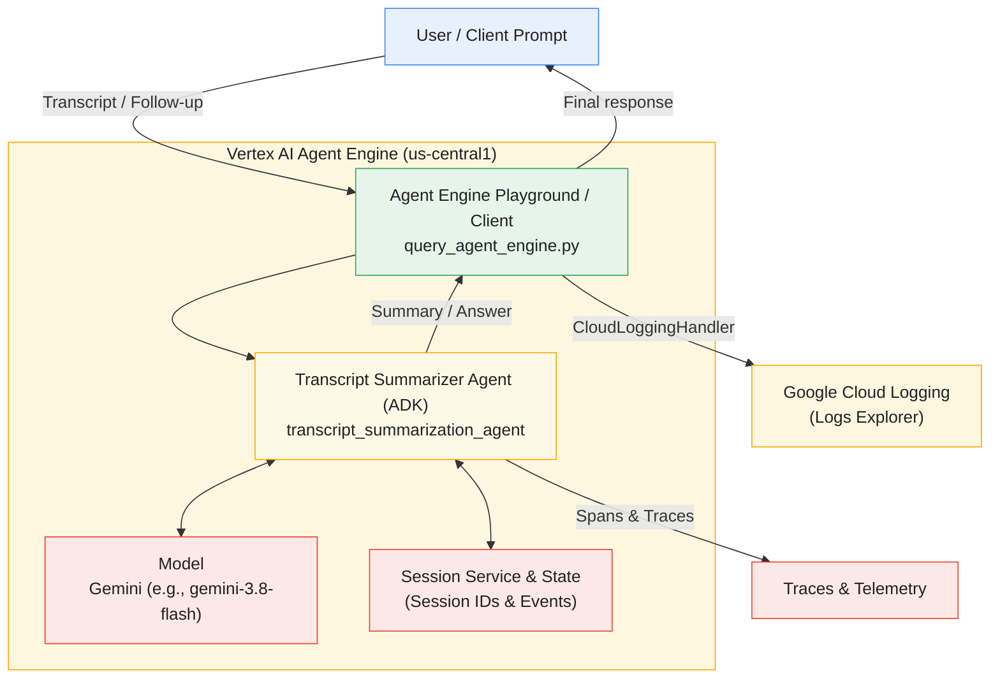

# 🤖 Transcript Summarizer Agent 📋

> 🎥 Watch **Transcript Summarizer Agent** in action! 📝

> [!CAUTION]
> The Vertex AI Agent Engine deployment is temporary and no longer active once the lab expires. The agent was deployed and tested successfully on Vertex AI Agent Engine (`us-central1`).

---

## Table of Contents

- [Introduction](#introduction)
- [Architecture Diagram](#architecture-diagram)
- [Project Structure](#project-structure)
- [Features](#features)
- [Tech Stack](#tech-stack)
- [Application Workflow](#application-workflow)
- [Screenshots](#screenshots)
- [Generative AI Capabilities & Integration](#generative-ai-capabilities--integration)
- [AI-Assisted Development](#ai-assisted-development)
- [Google Skills Challenge Lab Reference](#google-skills-challenge-lab-reference)
- [Future Enhancements](#future-enhancements)
- [Resources](#resources)
- [Disclaimer](#disclaimer)
- [Contributing](#contributing)
- [License](#license)
- [Author](#author)

---

## Introduction

**Transcript Summarizer Agent** is a stateful AI agent application developed as part of hands-on Google Cloud and generative AI learning experiences. It pairs a transcript summarization agent (`transcript_summarization_agent`) with deployment and querying utilities (`agent_engine_utils.py` and `query_agent_engine.py`), powered by **Google Agent Development Kit (ADK)**, **Gemini models**, and **Vertex AI Agent Engine** with **Google Cloud Logging** observability.

The project explores how to build and deploy interactive AI agents capable of summarizing multi-speaker conversations, extracting key issues, root causes, resolutions, and action items, maintaining multi-turn session history across sessions, and inspecting execution traces and runtime logs.

The repository organizes the agent package, Vertex AI Agent Engine deployment/query scripts, dependency specifications, and documentation into a clean, reproducible workspace (`adk_to_agent_engine`) ready for local testing and managed Agent Engine execution.

The project demonstrates practical concepts in ADK agent design, prompt/instruction engineering, managed session persistence, Cloud Logging integration, Python dependency management with `pip`, and serverless deployment on Vertex AI Agent Engine.

This repository documents my implementation and learning with Google Cloud Generative AI, ADK, Vertex AI Agent Engine, and Cloud Logging workflows, including project structure, supporting modules, and learning resources.

---

## Architecture Diagram

The following diagram illustrates the architecture of **Transcript Summarizer Agent**, connecting the user and ADK agent workflow with Vertex AI Agent Engine, session persistence, and Cloud Logging:

> [!NOTE]
> This diagram provides a high-level overview of the ADK agent execution loop, managed session state, Cloud Logging integration, and Vertex AI Agent Engine hosting architecture.

### Architecture Overview

1. **User / Client Prompt**
   - Sends raw conversation transcripts (such as customer support calls, team standups, or incident reviews) and follow-up questions to the agent.

2. **Transcript Summarizer Agent**
   - Orchestrates transcript comprehension, structured summary generation, sentiment/action-item extraction, and multi-turn conversational responses using `agent.py` and Gemini models.

3. **Vertex AI Agent Engine & Session State (`us-central1`)**
   - Hosts the deployed agent (`Transcript Summarizer`), manages session IDs and event histories (`Sessions` and `Playground`), and exposes execution spans (`call_llm`, `generate_content`) and traces.

4. **Google Cloud Logging & Staging**
   - Initializes Vertex AI with the project ID, `us-central1` location, and GCS staging bucket (`gs://<project_id>-bucket`), while streaming application and runtime logs (`CloudLoggingHandler`) to Cloud Logging.

---

## Project Structure

The repository organizes the `adk_to_agent_engine` workspace, agent package, deployment utilities, and project governance files into a clean layout.

> [!NOTE]
> This tree mirrors the repository workspace structure.

### Key Components

- `adk_to_agent_engine/transcript_summarization_agent/` — Contains the ADK agent (`agent.py`), Vertex AI / Cloud Logging initialization and querying logic (`query_agent_engine.py`), package initializer (`__init__.py`), and `requirements.txt`.
- `adk_to_agent_engine/agent_engine_utils.py` — Provides supporting utilities for deploying and interacting with Vertex AI Agent Engine.
- `adk_to_agent_engine/README-cloudshell.txt` — Default Cloud Shell workspace readme included from the lab environment.
- `.gitignore` — Excludes `.env` files, credentials, virtual environments (`.venv/`), and Python caches (`__pycache__/`) from version control.
- `CONTRIBUTING.md`, `CODE_OF_CONDUCT.md`, and `SECURITY.md` — Outline contribution standards, community conduct, and security-reporting guidelines.

---

## Features

- **Structured Transcript Summarization:** Condenses support, standup, and incident transcripts into clear summaries covering issues, root causes, resolutions, and action items.
- **Multi-Turn Session Memory & Session IDs:** Persists conversation events across turns and allows resuming or inspecting prior sessions by Session ID in the Playground.
- **Follow-Up & Structured Extraction:** Supports follow-up questions on sentiment, compensation, or speaker details, as well as reformatting action items into tables or bullet lists.
- **Built-In Traces & Cloud Logging:** Surfaces execution spans (`call_llm`, model generation) in the Playground alongside `ReasoningEngine` and custom `CloudLoggingHandler` logs in Logs Explorer.
- **Clean Secret & Cache Hygiene:** Configured with `.gitignore` to prevent accidental commits of `.env` files, credentials, or build/cache artifacts.
- **Modular Agent & Utility Separation:** Keeps `transcript_summarization_agent` and `agent_engine_utils.py` cleanly organized for maintainability.

> [!NOTE]
> Actual runtime behavior depends on valid Google Cloud credentials, enabled APIs, allowed models, staging bucket permissions, and proper environment configuration.

---

## Tech Stack

| Technology | Purpose |
|---|---|
| **Python** | Core programming language for ADK agent code and Agent Engine scripts |
| **Google Agent Development Kit (ADK)** | Agent definition and orchestration framework |
| **Vertex AI Agent Engine** | Managed runtime for deploying agents, sessions, and traces (`us-central1`) |
| **Gemini Models & Vertex AI** | Core LLM reasoning, transcript summarization, and conversational responses |
| **Google Cloud Logging** | Centralized log collection and LQL querying in Logs Explorer |
| **Google Cloud Storage (GCS)** | Staging bucket (`gs://<project_id>-bucket`) for Vertex AI initialization and artifacts |
| **`pip`** | Python package and environment dependency management |
| **Git & GitHub** | Version control and source code hosting |

> [!NOTE]
> The table describes the technologies and patterns reflected in the project implementation.

---

## Application Workflow

**Transcript Summarizer Agent** is structured around environment initialization, agent deployment to Vertex AI Agent Engine, interactive/programmatic querying, and observability inspection.

### 1️⃣ Environment & Dependency Setup

- Configure required environment variables (`GOOGLE_CLOUD_PROJECT`, `APP_NAME`, and any model/environment settings) in a local `.env` file while keeping `.env` out of version control.
- Install dependencies using
  `pip install -r adk_to_agent_engine/requirements.txt` and `pip install -r adk_to_agent_engine/transcript_summarization_agent/requirements.txt`.

### 2️⃣ Vertex AI & Cloud Logging Initialization

- Load environment variables via `load_dotenv()` and initialize `google.cloud.logging.Client` with `CloudLoggingHandler` (`name="transcript-summarizer"`).
- Initialize `vertexai.init(project=project_id, location="us-central1"`, `staging_bucket=f"gs://{project_id}-bucket")`.

### 3️⃣ Agent Deployment & Playground Testing

- Deploy `transcript_summarization_agent` (`Transcript Summarizer`) to Vertex AI Agent Engine and open the Playground tab.
- Send a transcript prompt to generate a structured summary, then send follow-up prompts (such as extracting action items into a table or checking sentiment) within the same session.

### 4️⃣ Session Persistence & Trace Inspection

- Switch between sessions or reopen a conversation by Session ID to verify multi-turn state retention.
- Inspect Events, Traces, associated spans (`call_llm`, model calls), and the Sessions tab for execution details.

### 5️⃣ Cloud Logging Verification

- Open Logs Explorer and filter by `resource.type="aiplatform.googleapis.com/ReasoningEngine"` or `logName="projects/<PROJECT_ID>/logs/transcript-summarizer"` to inspect runtime and model logs.

---

## Screenshots

This section showcases **Transcript Summarizer Agent** in action, including Cloud Shell / workspace setup, Vertex AI Agent Engine Playground sessions, traces, and Cloud Logging.

---

## Generative AI Capabilities & Integration

### ADK Agent Orchestration

- Defines and runs `transcript_summarization_agent` to parse multi-turn transcripts, extract structured summaries, and answer follow-up questions consistently.

### Vertex AI Agent Engine & Session State

- Manages deployed agent revisions, session IDs, conversation events, and execution traces on Vertex AI Agent Engine in `us-central1`.

### Gemini Model Reasoning & Cloud Logging

- Uses Gemini models to synthesize summaries, track conversational context, and format structured outputs, paired with Cloud Logging for operational visibility.

---

## AI-Assisted Development

AI tools can support the development and exploration of modern generative AI applications by helping explain unfamiliar code, investigate implementation issues, understand agent architectures, and improve technical documentation.

During the development and learning process for `Transcript Summarizer Agent`, AI assistance was used to support activities such as:

- Exploring Google ADK agent structure, prompts, and Vertex AI Agent Engine workflows.
- Testing transcript summarization prompts, multi-turn session follow-ups, and Logs Explorer queries.
- Structuring repository documentation, `.gitignore` rules, and contribution guides.

AI-generated suggestions and code should be reviewed critically, verified against the actual implementation, and tested before being adopted.

---

## Google Skills Challenge Lab Reference

This project was developed alongside hands-on Google Cloud learning lab modules.

### Challenge Lab

**Deploy ADK agents to Agent Runtime**

[Open the Google Skills lab](https://explore.qwiklabs.com/classrooms/21395/labs/115472)

### Learning Context

The repository serves as a personal source-code project associated with this learning experience.

It provides a place to explore and document:
- Building AI agents with Google ADK and Gemini models.
- Deploying agents to Vertex AI Agent Engine (`adk_to_agent_engine`).
- Managing Python dependencies with `requirements.txt`.
- Inspecting sessions, traces, and Cloud Logging output.

For official learning objectives, instructions, and environment setup requirements, refer to the lab link provided above.

--- 

## Future Enhancements

The following ideas could be considered for future versions of **Transcript Summarizer Agent**:

- **Structured Output Schemas:** Add typed output formats (such as JSON or standardized action-item schemas) for downstream CRM or ticketing integrations.
- **Automated Unit & Integration Tests:** Add `pytest` suites covering transcript summarization edge cases, session recall, and logging helpers.
- **Long-Transcript Chunking:** Support very long multi-speaker or meeting transcripts cleanly without losing early context or action items.
- **Evaluation Benchmarks:** Expand evaluation datasets in the Agent Engine Evaluation tab to measure summary accuracy and faithfulness.

> [!IMPORTANT]
> These are potential improvements, not claims that the features are already fully implemented.

---

## Resources

---

## Disclaimer

**Transcript Summarizer Agent** is a learning and demonstration project associated with Google Cloud training.

The project utilizes third-party technologies and services, including Vertex AI Agent Engine, Vertex AI, Gemini, Google Cloud Logging, and Python packages. The availability, functionality, pricing, and policies of external cloud services are subject to their respective providers' terms.

Access to Qwiklabs / Google Cloud lab environments and temporary GCP projects expires after completion or quota exhaustion. A completed lab does not imply permanent public availability of the deployed agent service.

This repository is intended for educational and demonstration purposes. Do not commit API keys, access tokens, service-account credentials, `.env` files, or private configuration files to source control.

---

## Contributing

Contributions are welcome! If you would like to improve **Transcript Summarizer Agent**, fix a bug, add tests, or improve the documentation, please review the following guidelines:

- [Contributing Guide](./CONTRIBUTING.md)
- [Code of Conduct](./CODE_OF_CONDUCT.md)
- [Security Policy](./SECURITY.md)

Please ensure that contributions are focused, documented, and tested where appropriate. Never include secrets or private configuration in issues, commits, or Pull Requests.

---

## License

This project is licensed under the **Apache License 2.0**.

See the [LICENSE](./LICENSE) file for details.

---

## Author

[**Sahil Sharma**](https://github.com/sahil-me)

Thank you for exploring **Transcript Summarizer Agent**! If you find the project useful, consider giving the repository a ⭐ to show your support.

